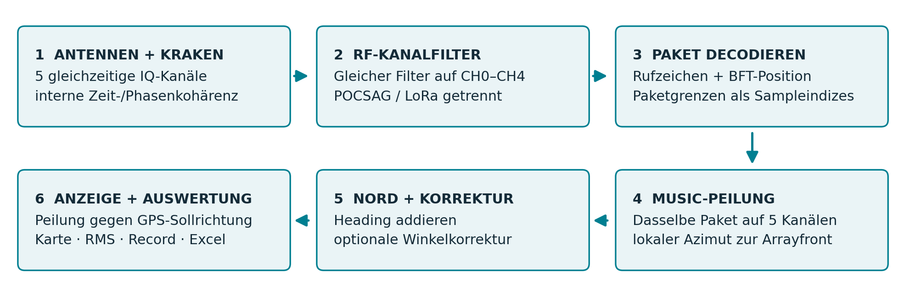
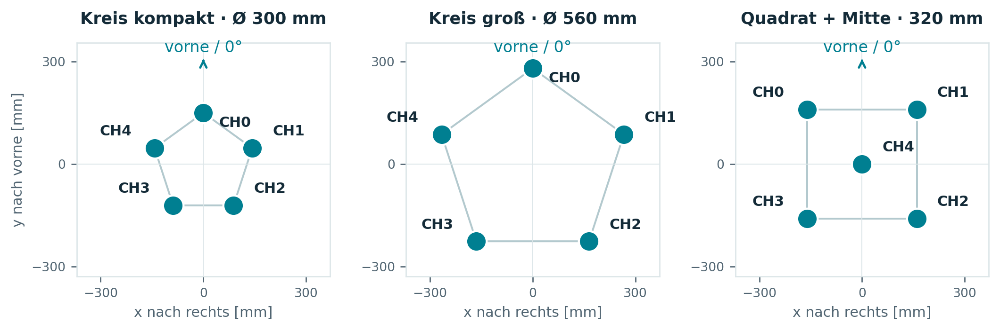
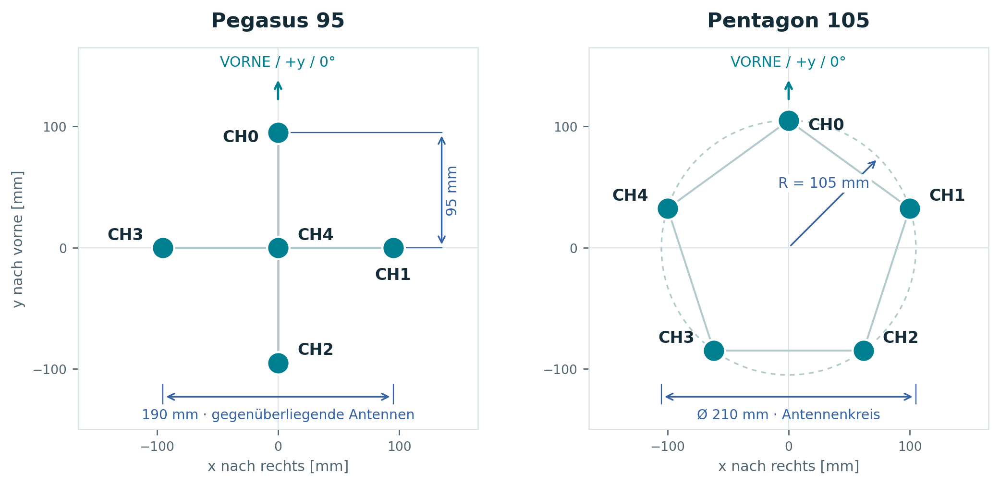
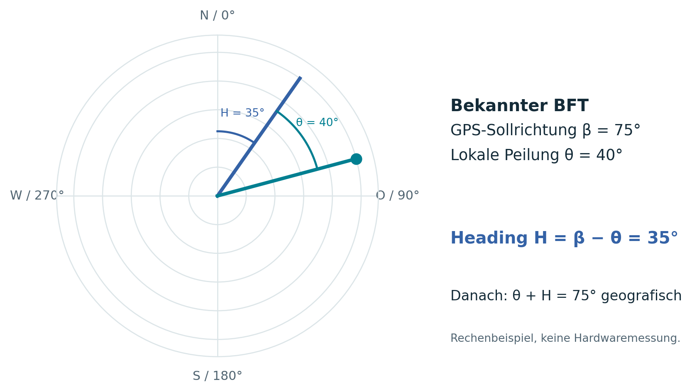
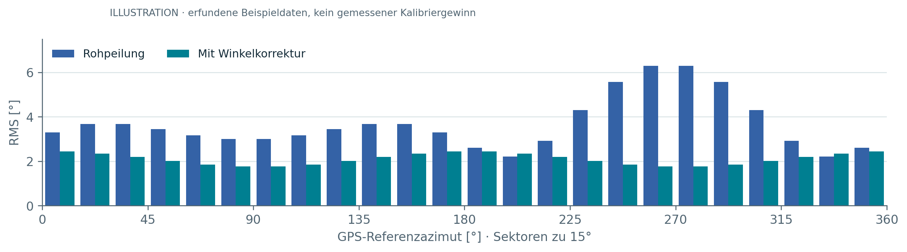

\begin{titlepage}
\thispagestyle{empty}
\vspace*{8mm}
{\color{dfcyan}\fontsize{13}{16}\selectfont\bfseries KRAKENDF\quad /\quad DEMO-SYSTEM}
\vspace{18mm}

{\fontsize{36}{42}\selectfont\bfseries Direction Finding\\[3mm]mit KrakenSDR}
\vspace{7mm}

{\fontsize{18}{25}\selectfont Funktion und Bedienung\\[2mm]BFT · POCSAG · LoRa · GPS-Referenz}
\vspace{12mm}

{\color{dfcyan}\rule{\textwidth}{1.5pt}}
\vspace{7mm}

Ein feststehendes Fünfantennen-Array peilt die Positionspakete bewegter
BFT-Emitter. Deren übermittelte GPS-Position ermöglicht den Vergleich
zwischen gemessener Richtung und geografischer Sollrichtung.

Dieses Handbuch erklärt das Peilprinzip, fünf Antennenprofile,
GPS-Status und Heading-Abgleich sowie Messung, Kalibrierung und Auswertung.
\vfill

\begin{tabular}{@{}ll}
Softwarestand & 0.2.3 · Quellstand \texttt{980d850}\\[2mm]
Dokumentstand & 17. November 2026 · Ausgabe 2\\[2mm]
Empfänger & KrakenSDR · fünf kohärente Empfangskanäle\\[2mm]
Positionsquelle & ARCELI VK-162 oder manuelle Stationsposition\\[2mm]
Bedienung & Lokales Webinterface unter \texttt{127.0.0.1:8080}
\end{tabular}
\vspace{8mm}

\href{https://github.com/schildtaero/krakensdr}{github.com/schildtaero/krakensdr}
\end{titlepage}

\tableofcontents
\vfill

**So nutzen Sie das Handbuch:** Für den ersten Betrieb Antennenaufbau,
Position/Heading, GPS-Anzeige und Live-Start lesen. Für Vergleichsmessungen
zusätzlich Record/Replay, Kalibrierung und RMS beachten. Diagnose und
Aktualisierung enthalten den Log-Download und Windows-Git-Befehle.

**Neu in dieser Ausgabe:** Pegasus 95 und Pentagon 105, Satelliten- und
Verbindungsanzeige, Paket-SNR, beschleunigte Verarbeitung und Diagnose-ZIP.

**Aussagegrenze:** Die Software und der native Linux-Build wurden geprüft.
Eine vermessene Genauigkeit des realen Kraken-/433-MHz-/VK-162-Aufbaus liegt
noch nicht vor. Zahlenbeispiele und entsprechend beschriftete Diagramme sind
Erklärungen, keine Messergebnisse.

\newpage

# Was das System misst

Die Demo empfängt die Positionssendungen mehrerer DL7CR-BFTs auf LilyGO
T-Deck 433. Jeder BFT sendet sein alphanumerisches Rufzeichen und, bei gültigem
GPS-Fix, seine Position per POCSAG oder LoRa. **Genau dieses Funkpaket wird
zugleich decodiert und gepeilt.** Die Emitter können sich bewegen; das
Empfangsarray bleibt an einem festen Ort.

{width=100%}

Die Software liefert zwei voneinander unterscheidbare Richtungen:

- **Peilung:** Aus den Phasenbeziehungen der fünf Empfangssignale berechneter
  Azimut, durch das Heading auf geografisch Nord bezogen.
- **GPS-Sollrichtung:** Aus Empfängerposition und übermittelter BFT-Position
  berechnete WGS84-Richtung. Sie dient als Vergleichsreferenz.

Die Differenz ist der Peilfehler. Das System zeigt Gesamt-RMS und Fehler nach
Azimut, speichert Messläufe und exportiert sie nach Excel. Ein anhand
getrennter Messläufe geprüftes Modell kann systematische Winkelabweichungen
zusätzlich verringern.

**Eine einzelne Peilstation misst eine Richtung und keine eindeutige
Entfernung.** Die Emitterposition auf der Karte stammt aus der decodierten
BFT-GPS-Meldung. Sie wird nicht durch Triangulation aus dieser einen Peilung
erzeugt. Auch ein übermitteltes Rufzeichen ist eine Paketkennung, keine
authentifizierte Senderidentität.

Mehrere RF-Kanäle werden innerhalb desselben Aufnahmefensters verarbeitet.
Im jeweiligen Kanal setzt die aktuelle Peilberechnung einen dominierenden
Sender pro Paket voraus. Der geplante Abstand von ungefähr 15 Sekunden je
BFT ist daher mit einer kollisionsfreien Zeitplanung pro Kanal zu verbinden.

\newpage

# Von fünf Signalen zum Peilwinkel

Eine einfallende Funkwelle erreicht räumlich getrennte Antennen mit kleinen
Laufzeitunterschieden. Bei einer schmalbandigen Welle erscheinen diese als
**Phasenunterschiede**. Bei 433 MHz beträgt die Wellenlänge ungefähr 69,2 cm;
eine Wegdifferenz von einer halben Wellenlänge entspricht 180° Phase.

Für eine horizontale ebene Welle beschreibt das Arraymodell jeden Kanal $m$:

$$a_m(\theta)=\exp\!\left(j\,\frac{2\pi f}{c}
    [x_m\sin\theta+y_m\cos\theta]\right).$$

$f$ ist die RF-Frequenz, $c$ die Lichtgeschwindigkeit und $(x_m,y_m)$ die
Antennenposition. **x zeigt nach rechts, y nach vorne; 0° liegt vorne,
positive Winkel drehen im Uhrzeigersinn.** Die Kanalzuordnung muss der
physischen Verkabelung entsprechen.

Aus den fünf IQ-Zeitreihen im Paketfenster entsteht die Kovarianzmatrix
$R=XX^{\mathrm H}/N$. MUSIC zerlegt sie in Signal- und Rauschanteile und
vergleicht das gemessene räumliche Muster mit den für 0° bis 359° erwarteten
Mustern. Das Maximum des MUSIC-Pseudospektrums ergibt die lokale Richtung.
Die Implementierung verwendet ein 1°-Raster mit anschließender
Peakinterpolation; für die Kovarianz werden höchstens 32.768 gleichmäßig
verteilte Samples verwendet.

Das Ergebnis ist **keine garantierte Genauigkeit von 1°**. Rauschen,
Reflexionen, Antennenkopplung und ein falsches Arraymodell können die Peilung
deutlich verschieben. Auch ein schmaler MUSIC-Peak beweist allein keine
richtige Richtung. Die dargestellte DF-Qualität ist ein Score aus dem
Eigenwertabstand, keine Unsicherheit in Grad.

| Voraussetzung | Bedeutung für den Aufbau |
|:--|:--|
| Fünf kohärente Kanäle | Zeit- und Phasenbezug müssen erhalten bleiben. |
| Passendes Arraymodell | Positionen und Eingang CH0–CH4 müssen stimmen. |
| Ein dominierender Sender | Überlagerungen im selben Paketkanal vermeiden. |
| Näherungsweise horizontales Fernfeld | Keine Genauigkeitsannahme für sehr nahe oder stark erhöhte Quellen. |

Die **FFT-Länge** im Setup beeinflusst die Spektrumsdarstellung. Sie stellt
weder das MUSIC-Winkelraster noch unmittelbar die DF-Integrationszeit ein.

\newpage

# Antennen aufstellen und zuordnen

Als Ausgangspunkt empfiehlt sich **Kreis groß – 560 mm**. Alle fünf
Magnetfußantennen senkrecht, auf gleicher Höhe und mit vergleichbarer
Umgebung aufstellen. Eine geeignete metallische Grundfläche, möglichst
gleiche elektrische Kabellängen und feste Kanalbeschriftungen sind wichtig.

{width=100%}

| Profil | Aufbau und Kanalreihenfolge | Einordnung |
|:--|:--|:--|
| Kreis kompakt | Ø 300 mm; CH0 vorne, CH1–CH4 im Uhrzeigersinn, jeweils 72° | Platzsparend; kleinere Apertur und stärkere mögliche Kopplung. |
| Kreis groß | Ø 560 mm; gleiche Kanalreihenfolge; Nachbarabstand 329 mm | Größere Apertur; sinnvoller Start für den Vergleich. |
| Quadrat mit Mitte | Seite 320 mm; CH0 vorne links, CH1 vorne rechts, CH2 hinten rechts, CH3 hinten links, CH4 Mitte | Andere Geometrie; ausdrücklich dieses Profil wählen. |

**Aufbau in fünf Schritten:** Vorderseite dauerhaft markieren; Positionen
ausmessen; Antennen und Kabel mit CH0–CH4 beschriften; gleichnamiges Profil
im Setup wählen; Kanalfolge anschließend an bekannten Richtungen prüfen.
Die genauen Koordinaten stehen in `config/antenna-presets.json` und
`docs/antennen.md`.

Kabeltausch, verrückte Antennen oder eine geänderte Grundfläche verändern die
reale Arrayantwort. Die interne Kraken-Kalibrierung beseitigt solche externen
Einflüsse nicht zuverlässig. Für jedes tatsächlich veränderte Layout sind
Heading und Messvergleich neu zu prüfen und die alte Winkelkorrektur zu
deaktivieren. Die Software erkennt ein physisches Verschieben nicht selbst.

Ein größeres Array garantiert keinen kleineren Fehler: Nebenmaxima,
Mehrwegeausbreitung und Montage können den Aperturvorteil aufheben. Genau
diesen Zusammenhang soll die Demo messen.

\newpage

# Pegasus 95 und Pentagon 105

Die beiden kompakten Profile sind zusätzlich auswählbar. **CH0 zeigt bei
beiden nach vorne.** Beim Pegasus-Originalentwurf liegt diese Richtung links
in der Zeichnung; hier sind die Profile in lokalen Softwarekoordinaten
mit der Vorderseite oben dargestellt.

{width=100%}

| Kanal | Pegasus 95: x / y [mm] | Pentagon 105: x / y [mm] |
|:--|--:|--:|
| CH0 | 0 / +95 | 0 / +105 |
| CH1 | +95 / 0 | +99,9 / +32,4 |
| CH2 | 0 / −95 | +61,7 / −84,9 |
| CH3 | −95 / 0 | −61,7 / −84,9 |
| CH4 | 0 / 0 | −99,9 / +32,4 |

**Pegasus 95** ist ein Kreuz mit 95 mm Armlänge, 190 mm zwischen
gegenüberliegenden Antennen und CH4 in der Mitte. **Pentagon 105** hat
105 mm Radius, also 210 mm Durchmesser des Mittelpunktskreises. CH1–CH4
folgen CH0 in 72°-Schritten im Uhrzeigersinn; es gibt keine Mittelantenne.
Die Tabelle ist gerundet; die Software nutzt die hinterlegten Koordinaten.

Unter **Setup → Antennenprofil** das tatsächlich aufgebaute Profil wählen.
Eine bisher gespeicherte Auswahl wird durch ein Update nicht automatisch
geändert. Das Heading beschreibt beim Pegasus die Richtung von CH4 zu CH0.
Für einen Druckhalter Fußdurchmesser, Wandstärke und Brim zu den
Mittelpunktsmaßen hinzurechnen. Die Druckbettgröße allein bestimmt keine
RF-Genauigkeit.

\newpage

# Empfangskette und Kohärenz

Der lokale Live-Modus startet den mitgelieferten Heimdall-/Kraken-Stack.
Dieser liest fünf Tuner, ordnet Samples zeitlich zu und stellt den
Phasenbezug her. Die App übernimmt Konfiguration und Prozessverwaltung.
**Ein laufender Prozess oder fünf sichtbare USB-Geräte beweisen noch keine
kohärenten Messdaten.**

Die Anwendung prüft die tatsächlichen IQ-Header. CAL-/DUMMY-Frames,
fehlender Delay-/IQ-Lock, aktive Kalibrierrauschquelle, ADC-Übersteuerung
sowie leere oder nicht endliche Samples werden nicht als gültige
Peilfenster verwendet. Lücken und Streamwechsel setzen den Empfangszustand
zurück; Samples über solche Grenzen hinweg dürfen nicht zusammengemischt
werden.

| Stufe | Was sie korrigiert | Was dafür benötigt wird |
|:--|:--|:--|
| Kraken-Kohärenz | Relative Zeit- und Phasenfehler der internen Empfangskette | Rauschquelle und gültige interne Locks. |
| Geografisches Heading | Gemeinsame Drehung der lokalen Arrayfront gegenüber Nord | Bekannter BFT oder manuelle Ausrichtung. |
| Gelernte Winkelkorrektur | Wiederholbare azimutabhängige Restabweichung des Aufbaus | Trainingsdaten und unabhängiger Prüflauf. |

Diese drei Stufen wirken nacheinander. Ein Heading-Abgleich repariert keine
vertauschten Kanäle. Eine gelernte Winkelkorrektur ersetzt keine
RF-Kohärenz und kann einen stark falschen Aufbau nicht sinnvoll retten.

Die native gebündelte Stufe läuft mit **Dezimierung 1 und FIR-Länge 1**.
Die identische RF-Kanalfilterung aller fünf Antennen übernimmt anschließend
die Anwendung. Standardmäßig werden 2,4 MS/s empfangen; alle aktivierten
POCSAG-/LoRa-Kanäle müssen gleichzeitig in dieses RF-Fenster passen.

Die GPS-Maus liefert die Stationsposition, aber keinen PPS-synchronisierten
Sampletakt für den Kraken. Paket und Peilung werden durch **Sampleindizes
und Stream-Epochen** verknüpft. Gespeicherte Empfangszeiten werden aus der
Hostuhr geschätzt; sie sind keine präzise GPS-Zeitstempelung jedes RF-Samples.

\newpage

# POCSAG und LoRa

Für jeden RF-Kanal wird derselbe Frequenzversatz und Filter auf alle fünf
Antennen angewandt. Der Decoder liest einen geeigneten Antennenkanal. Seine
Paketgrenzen bestimmen anschließend den zugehörigen Ausschnitt der fünf
kohärenten Kanäle für MUSIC. Die Zuordnung zum Emitter entsteht aus dem
**alphanumerischen Rufzeichen im Paket**, nicht allein aus Frequenz oder
POCSAG-RIC.

| Betriebsart | Implementierter Empfangspfad |
|:--|:--|
| POCSAG | BFT-Modus mit 1200 Bit/s, etwa ±4,5 kHz FSK-Hub; BCH-/Paritätsprüfung, bis zu zwei Bitfehler je Codewort korrigierbar. Kein zusätzlicher Payload-CRC. |
| LoRa | SF7–SF12, Modulationsbandbreite 125/250/500 kHz, expliziter Header und gültiger Payload-CRC. BFT-Quellstand: SF9/BW125 kHz/CR4/5; tatsächliche Tracker-Einstellungen prüfen. |

**Reicht ein kurzer LoRa-Burst?** Grundsätzlich kann auch ein kurzer Burst
gepeilt werden, wenn ausreichend kohärente, brauchbare Samples vorhanden
sind. Größere Bandbreite verkürzt bei sonst gleichen Parametern die
Symboldauer: $T_\mathrm{Symbol}=2^{SF}/BW$. Bei SF9 und BW125 kHz sind es
4,096 ms je Symbol; die gesamte Airtime hängt zusätzlich von Präambel,
Header, Coderate und Nutzlast ab.

Die Arraylaufzeit ist dagegen sehr klein: über 0,56 m höchstens ungefähr
1,87 ns. Selbst 500 kHz Bandbreite erzeugen darüber nur etwa 0,0059 rad
zusätzliche Phasenspanne. Die räumliche Schmalbandannahme ist für diesen
Aufbau deshalb plausibel. Entscheidend bleiben Trigger, vollständiges Paket,
SNR, Locks und Rechenleistung des Hosts.

Die aktuelle Anzeige erfordert ein erfolgreich zugeordnetes BFT-Paket.
Eine reine Chirperkennung oder ein Paket mit falschem LoRa-CRC erzeugt keine
gültige Emitter-/Referenzmessung. **LoRa bleibt experimentell und am realen
433-MHz-Aufbau zu erproben.** Ein erfolgreicher einkanaliger
868,3-MHz-Pluto-Referenzdecode belegt keine Kraken-Peilgenauigkeit.

Für die Kanalkonfiguration gelten:

$$|f_\mathrm{Kanal}-f_\mathrm{Mitte}|+\frac{BW_\mathrm{Kanal}}{2}
\leq 0{,}45\,f_s.$$

Aktive Kanalfilter dürfen sich nicht überlappen. LoRa benötigt mindestens
10 % Filterreserve: bei BW125 kHz mindestens 137,5 kHz Kanalbandbreite;
150 kHz ist ein passender Ausgangswert.

\newpage

# SNR und Verarbeitungsreserve

**02 / Tracking** zeigt pro Rufzeichen und in den Emitterdetails das
geschätzte Paket-SNR im jeweiligen Empfangskanal. Gemittelt werden die
Leistungen aller fünf Antennen. Aus ruhigen Bereichen vor oder nach der
erkannten Aktivität wird eine Rauschreferenz bestimmt:

$$\mathrm{SNR}_{\mathrm{dB}}=10\log_{10}
\!\left(\frac{P_{\mathrm{Paket}}-P_{\mathrm{Rauschen}}}
{P_{\mathrm{Rauschen}}}\right).$$

Die Referenz liegt mindestens 2 ms außerhalb der Aktivitätsgrenzen und
umfasst mindestens 5 ms sowie 64 Samples. Widersprüchliche oder stark
schwankende Referenzen werden verworfen. **Negative dB-Werte sind gültig;
„—“ bedeutet kein belastbarer Schätzwert.** Ein nicht auflösbarer
Signalanteil wird nicht als künstlicher 0-dB-Wert angezeigt.

Das SNR ist unkalibriert und hängt von der Kanalbandbreite ab. Es ist kein
DF-Score, keine Winkelunsicherheit und kein nach LoRa-Dechirping gewonnener
Wert. In der Simulation stammt es aus dem bekannten künstlichen Rauschmodell.
Verfahren, Wert und Status werden gespeichert und nach Excel exportiert.

## Warum 2,4 MS/s anspruchsvoll sind

Fünf Antennen bei 2,4 MS/s bedeuten zwölf Millionen komplexe Eingangssamples
pro Sekunde. Der optionale Numba-Pfad verbindet Mischung, unveränderten
kausalen Filter und Dezimierung und vermeidet große Zwischenarrays. Er wird
vor Empfangsbeginn vorbereitet; ohne Numba bleibt SciPy nutzbar. Die lokale
DAQ-Installation bringt Numba bereits mit.

| Softwarebenchmark: zwei RF-Kanäle bei 2,4 MS/s | Median je Frame |
|:--|--:|
| Ursprüngliche Kanalverarbeitung | 471,7 ms |
| Zusammengefasster Numba-Pfad | 259,4 ms |
| Im Frame enthaltene Empfangsdauer | 436,9 ms |

Das entspricht etwa 1,82-fachem Durchsatz auf dem Entwicklungsrechner.
Gemessen wurden Kanalverarbeitung, Spektrum und Burst-Erkennung;
USB/DAQ, Decoder, MUSIC und Aufnahme sind darin nicht enthalten.
Der Benchmark ist keine Echtzeitzusage für den Zielhost.

**Status → Verarbeitung** zeigt Pipeline/RF-Zeit, Warteschlangen und
Bearbeitungszeiten. Dauerhaft über 100 % bedeutet Rückstau der RF-Pipeline;
der Wert ist keine Gesamt-CPU-Auslastung. Decodierung und MUSIC laufen in
einem getrennten Worker. Die Grenzen bleiben drei wartende RF-Frames und
acht Bursts; Überlast bleibt ein sichtbarer Fehler. Ein kleinerer FFT-Wert
ersetzt keine ausreichend schnelle Kanalverarbeitung.

\newpage

# Position und Heading richtig setzen

Unter **Setup → Stationsposition & GPS** die GPS-Maus oder die manuelle
Stationsposition auswählen. Für die VK-162 zunächst 9600 Baud verwenden;
bei Bedarf **GPS-Ports suchen** und einen eindeutigen Port wählen. Unter
Linux/WSL ist dies häufig `/dev/ttyACM0` oder `/dev/ttyUSB0`.

Bei GPS-Betrieb mittelt die Anwendung zehn zeitlich verschiedene gültige
Positionsmeldungen und fixiert dann den Standort. RMC und GGA derselben
UTC-Epoche zählen einmal. **Diesen Anker vor einer Aufnahme abwarten:**
Während einer Aufnahme wird er nicht neu aufgebaut. Ein späterer Ausfall
der GPS-Maus verwirft einen vorhandenen festen Stationsanker nicht. Nach
einem Stationsumzug den Backendprozess neu starten, den Anker neu bestimmen
lassen und das Heading prüfen.

{width=83%}

**Abgleich mit bekanntem Emitter:**

1. Array und Referenz-BFT ruhig halten; Empfängerposition und BFT-GPS prüfen.
2. Einige gute Positionspakete dieses Rufzeichens empfangen.
3. **Heading ausrichten → Referenzemitter → Heading setzen** wählen.
4. Weitere Pakete empfangen und den Abgleich aus einer zweiten Richtung prüfen.

Die Software bildet das zirkuläre Mittel aus GPS-Sollrichtung minus lokaler
Peilung der letzten bis zu fünf akzeptierten Messungen. Technisch genügt
eine; mehrere stabile Pakete sind vorzuziehen. Der letzte Empfang darf
höchstens 45 Sekunden zurückliegen. Beim ungefähr 15-s-Sendeintervall dauert
das Sammeln von fünf Paketen etwa eine Minute.

Manuell lässt sich **Setup → Antennen & Ausrichtung → Geografisches
Heading °** setzen. Es gilt geografisch Nord, nicht magnetisch Nord.
Der GPS-Kurs einer stillstehenden VK-162 ist kein Array-Heading.
Heading-Änderungen setzen die Statistik zurück und deaktivieren die
Winkelkorrektur; Aufnahme und Replay vorher beenden.

\newpage

# GPS-Verbindung und Satelliten

Die GPS-Kachel zeigt die tatsächliche Hardwaretelemetrie unabhängig davon,
ob die Stationsreferenz manuell, simuliert oder aus einer Aufnahme stammt.
Ein Klick öffnet den Detaildialog mit Port/Baudrate, Datenalter, Satelliten,
Signalbalken, HDOP und Fortschritt der Standortmittelung.

| Zustand | Bedeutung |
|:--|:--|
| Nicht gefunden / nicht eingerichtet | Kein eindeutiger GPS-Port oder keine passende Konfiguration. USB/WSL und Portwahl prüfen. |
| Verbunden, noch keine Daten | Serieller Port offen, aber bislang keine Bytes angekommen. |
| Daten, kein gültiges NMEA | Bytes kommen an; aktuelle prüfsummengültige Meldungen fehlen. Baudrate und Port prüfen. |
| Satellitensignal, noch kein Fix | Positive Signalwerte werden gemeldet; eine gültige Position fehlt noch. |
| Gültiger Fix, ggf. 2D / 3D | Aktuelle gültige Positionsmeldung; Fixart nur bei entsprechender Empfängermeldung. |
| Veraltet / Verbindungsfehler | Aktualisierungen fehlen oder Portzugriff/Lesen ist gescheitert. |

Die Hauptanzeige kann beispielsweise **Signal 3 · Sichtfeld 9 · Fix 0**
zeigen. Die Werte haben unterschiedliche Bedeutungen:

- **Signal:** Satelliten mit gemeldetem positivem C/N0-Wert.
- **Sichtfeld:** vom Empfänger per GSV gemeldete Satelliten.
- **Fix:** laut GGA/GSA für die Positionslösung verwendete Satelliten.

**0 ist eine gemeldete Null; „—“ steht für unbekannt oder veraltet.** Eine
Maus kann eine gültige Position liefern, ohne GSV-Sichtfeld oder Signalwerte
auszugeben. Mehrteilige GSV-Meldungen werden vollständig zusammengesetzt;
mehrere Signalbänder sollen Satelliten nicht doppelt zählen.

Die Balken im Dialog zeigen **C/N0 in dB-Hz**. Sie gehören zum GNSS-Empfang;
das SNR im Tracking beschreibt die 433-MHz-Pakete. Positions-/Datenmeldungen
gelten nach ungefähr fünf Sekunden als veraltet, Satellitenwerte nach zehn.
GSA/GSV aktualisieren keinen alten Positionszeitstempel. Auch bei Ausfall der
Backend-Verbindung altern die sichtbaren Angaben im Browser weiter.

**GPS neu verbinden** öffnet den konfigurierten Port erneut. Bei leerem Port
und GPS-Positionsquelle wird automatisch gesucht. Aufnahme und Replay vorher
beenden. Ein vorhandener Stationsanker bleibt dabei erhalten. Beim Erststart
die VK-162 mit freier Sicht zum Himmel platzieren und gegebenenfalls mehrere
Minuten auf den ersten Fix warten. Eine stillstehende GPS-Maus liefert kein
verlässliches Array-Heading.

\newpage

# Den ersten Live-Lauf starten

**Vorbereiten:** Fünf Antennen passend zum Profil montieren, Kraken über
Datenkabel und geeignete Stromversorgung anschließen, VK-162 mit freier
Sicht zum Himmel platzieren. Die BFT-Frequenzen, Modulation und
LoRa-Einstellungen müssen bekannt sein. Einmalige Paketinstallation und
DAQ-Build benötigen Internet; der spätere normale Start arbeitet lokal.

| Host | Start im Projektordner |
|:--|:--|
| Linux | `./start.sh` |
| Windows mit lokalem Kraken | `start.cmd` — verwendet WSL2/Ubuntu 24.04. |
| Ohne Hardware, bewusst simulieren | `./start.sh --source simulation` bzw. `start.cmd --source simulation` |

Anschließend **http://127.0.0.1:8080** öffnen. Live ist voreingestellt;
fehlende Hardware bleibt als Fehler sichtbar. Es gibt keinen automatischen
Rückfall auf Simulation.

**Unter Windows einmalig:** Ubuntu mit einem regulären Linux-Benutzer
einrichten. Mit `usbipd list` die fünf tatsächlichen Kraken-Interfaces und
die GPS-Maus identifizieren. Die jeweiligen Geräte einmal in einer
administrativen PowerShell freigeben und an die laufende WSL anbinden:

```powershell
usbipd bind --busid <aktuelle-ID>
usbipd attach --wsl --busid <aktuelle-ID>
wsl -d Ubuntu-24.04 -- lsusb
```

Die ersten zwei Befehle pro Gerät ausführen; Platzhalter ersetzen. BUSIDs
können sich ändern. Der Kraken-Start prüft fünf eindeutige Tuner-Seriennummern
1000–1004. Die GPS-Maus muss ebenfalls in WSL verfügbar sein.

**Ablauf im Webinterface:**

1. **Setup:** RF-Mitte, Abtastrate, Gain, RF-Kanäle und Antennenprofil setzen.
   Die voreingestellten Frequenzen sind Beispiele und müssen zu den BFTs passen.
2. Stationsanker abwarten oder Position manuell setzen; Heading abgleichen.
3. Unter **Status** Empfangskette und Decoder prüfen; auf gültige Pakete warten.
4. Im **Lagebild** Peilung und GPS-Sollrichtung vergleichen.
5. Erst danach **Aufnehmen** starten und den gewünschten Lauf dokumentieren.

Diskreten Gain so wählen, dass die Pakete gut empfangen werden und keine
Übersteuerung entsteht. Ein höherer Gain verbessert die Peilung nicht
automatisch. Der angezeigte Pegel ist relativ, nicht in dBm kalibriert.

\newpage

# Lagebild, Karte und Offlinebetrieb

Im **Lagebild** stehen die Tabs **Azimut** und **Karte** zur Verfügung. Die
durchgezogene Linie zeigt die Peilung; die gestrichelte Linie die
GPS-Sollrichtung. Vor der Interpretation stets den Quellenzustand prüfen:
**Live, Simulation und Replay sind verschiedene Datenarten.**

Im Azimutdiagramm lässt sich schnell erkennen, ob sich ein Emitter bewegt,
ein konstanter Heading-Versatz besteht oder die Richtung stark springt.
Spektrum und Wasserfall zeigen, wann und wo die Sendungen auftreten. Eine
sichtbare Spektrallinie allein ist noch kein erfolgreich decodiertes und
zugeordnetes Paket.

Die Karte zeigt den Empfänger, seine Vorder-/Heading-Richtung, die
übermittelten Emitterpositionen sowie Peil- und Referenzlinien. Auf einen
Emitter klicken, um **Zugehörigkeit**, **Dimension**, Landkategorie,
**SIDC** und optional **Anzeigename** einzustellen; anschließend
**Symbol speichern**. Die Zuordnung bleibt an das Rufzeichen gebunden.
Die Symbolbibliothek unterstützt die hier verwendete APP-6(B)-kompatible
15-stellige SIDC-Auswahl, nicht sämtliche APP-6-Generationen.

## Die Karte für eine Demo ohne Internet vorbereiten

Die Anwendung startet mit **Offline** aktiviert. Dann werden nur lokale
Kacheln verwendet. Für einen planbaren Offlinebereich ist eine passende
**Raster-MBTiles-Datei** der verlässlichste Weg:

1. Im Karten-Tab **MBTiles importieren** wählen.
2. PNG-/JPEG-Raster-MBTiles bis 512 MiB importieren; Vektor-/PBF-MBTiles
   werden nicht unterstützt.
3. Geplantes Gebiet und benötigte Zoomstufen aufrufen und offline prüfen.

Alternativ **Offline** vorübergehend abwählen und das Gebiet online
betrachten. Nur tatsächlich angeforderte OSM-Kacheln werden gepuffert;
es gibt keinen automatischen Gebietsdownload. Anschließend Offline wieder
aktivieren und sämtliche benötigten Ansichten testen.

Eine gespeicherte Zoomstufe deckt andere Zoomstufen nicht automatisch ab.
Fehlende Kacheln werden als Koordinatenraster kenntlich gemacht. Symbole,
Heading und Peillinien bleiben auch ohne Kartenhintergrund nutzbar.
Quellenangaben der Karte bleiben sichtbar.

\newpage

# Record, Replay und Excel

**Aufnehmen → Name der Aufnahme → Verwendung: Messung / Demo → Aufnahme
starten** legt einen Messlauf an. Ein sinnvoller Name enthält Layout,
RX-Einstellung, Modulation und Rundennummer. Mit **Aufnahme stoppen**
abschließen. Profiländerungen sind während einer Aufnahme gesperrt.

Gespeichert werden die zugeordneten paketbezogenen Fünfkanal-IQ-Ausschnitte,
Peilwerte, BFT-/Stationspositionen, Qualitätsmerkmale, Spektrum und das
Messprofil. Die Daten liegen standardmäßig unter `~/.krakendf`.
**Es ist keine kontinuierliche Breitbandaufzeichnung.** Später lassen sich
keine RF-Kanäle decodieren, die nicht in den gespeicherten Paketfenstern
enthalten sind. Eine vollständige Archivierung aller unzugeordneten Bursts
steht nicht als Bedienoption bereit.

## Eine vorbereitete Aufnahme wiedergeben

Unter **Replay** die abgeschlossene Sitzung wählen und **Replay** starten.
Geschwindigkeiten von 0,5× bis 10× sind auswählbar. Die Live-Erfassung wird
dabei beendet; MUSIC berechnet die Peilung erneut aus den gespeicherten
IQ-Fenstern. Das gespeicherte Profil und die aufgezeichnete Korrekturversion
werden übernommen. Beliebige neue Profile oder Headings lassen sich im
Replay-Dialog nicht einstellen.

Die gespeicherten korrigierten Werte sind im Sitzungsexport enthalten;
die Replay-Anzeige zeigt derzeit die Rohpeilung.

Nach **Beenden** steht die Quelle still. Für echten Empfang ausdrücklich
wieder **Live** auswählen. Ein aufgezeichneter realer Lauf ist der passende
Demo-Ersatz bei Hardwareausfall; ein Simulationslauf bleibt als solcher
markiert und ist kein Nachweis des Funkempfangs.

## Excel-Export richtig wählen

**Analyse → Excel exportieren** exportiert die aktuelle Auswertung.
Unter **Replay / Aufnahmen → Excel** wird dagegen die gewählte gespeicherte
Sitzung exportiert. Für vollständige Vergleichsläufe den Sitzungsexport
verwenden: Die laufende Statistik hält höchstens 20.000 Beobachtungen vor,
eine Aufnahme speichert den gesamten Lauf.

| Tabellenblatt | Inhalt |
|:--|:--|
| Sitzung | Quelle, Messprofil und Aufnahmemetadaten. |
| Messungen | Einzelwerte, Winkel, Fehler, SNR mit Verfahren/Status sowie Qualitäts- und Paketdaten. |
| Gesamt | Gesamt-RMS, Bias, Anzahl und Abdeckung. |
| Azimut | Werte je Referenzazimutsektor. |
| Kalibrierung | Zugehörige Modelle und Prüfresultate. |

TX-Leistung, TX-Antenne, Firmware, Aufstellungsort und Kabelverlegung in der
Messnotiz oder im Messprotokoll festhalten. Aufnahmen und lokale Karten
werden nicht automatisch in das GitHub-Repository hochgeladen.

\newpage

# Winkelkorrektur mit Prüflauf

Erst Kohärenz, Montage und Heading stabilisieren. Die gelernte Korrektur
modelliert danach den verbleibenden, vom Azimut abhängigen Bias. Sie
verbessert keine verlorenen Pakete und ersetzt keine korrekte Verkabelung.
Für Training und Prüfung müssen **die vollständige Konfiguration, der
Aufbau und die Datenart** übereinstimmen.

1. **Kalibrierung öffnen → Record Calibration Data** wählen. Die Verwendung
   **Kalibrierung · Training** ist vorbelegt. Emitter um das feste Array
   bewegen und danach die Aufnahme stoppen.
2. Über **Prüflauf aufnehmen** eine neue, unabhängige Runde mit Verwendung
   **Kalibrierung · unabhängiger Prüflauf** aufzeichnen und stoppen.
3. **Trainingsaufnahme** und **Unabhängiger Prüflauf** auswählen;
   **Korrektur berechnen & prüfen** ausführen.
4. **PRÜFLAUF · VORHER/NACHHER** vergleichen. Nur bei Freigabe
   **Korrektur anwenden**. Mit **Korrektur deaktivieren** zurückschalten.

| Bedingung | Aktuelle Freigaberegel |
|:--|:--|
| Richtungsabdeckung | 24 Sektoren zu je 15°, nach GPS-Referenzazimut. |
| Training | Mindestens 3 gültige Werte je Sektor, also mindestens 72. |
| Prüflauf | Mindestens 1 gültiger Wert je Sektor, also mindestens 24. |
| Unabhängigkeit | Verschiedene abgeschlossene Sitzungen/Lauf-IDs; keine gemeinsamen Paketidentitäten. |
| Grobe Fehlmessungen | Fehler über 45° werden für den Fit ausgeschlossen. Montage und Heading zuerst prüfen. |
| Aktivierung | RMS-Abnahme im Prüflauf strikt größer als max(0,05°; 1 % des vorherigen RMS). |

Das Modell ist eine glatte periodische Fourierfunktion dritter Ordnung mit
sieben Koeffizienten. Es wird gegen den rohen geografischen Peilwinkel
gefittet; Sektorgewichtung und Regularisierung begrenzen die Dominanz
überfüllter Richtungen. Die berechnete Biasfunktion wird vom Winkel
abgezogen und das Ergebnis auf 0–360° gebracht.

Eine zweite Runde ist keine unabhängige Prüfung, wenn dieselben Pakete nur
anders benannt oder aufgeteilt werden. Die Mindestanzahlen sind
Abdeckungsregeln, kein statistischer Genauigkeitsnachweis. Mehr Daten aus
mehreren getrennten Runden sind vorzuziehen. Bei einem einzigen BFT mit
15-s-Intervall benötigen allein 72 + 24 Pakete nominell etwa 24 Minuten,
zuzüglich Ausfällen und einer gleichmäßigen Richtungsverteilung.

Jede Konfigurationsänderung deaktiviert die Korrektur. Auch Änderungen an
FFT oder Notiz können wegen des strikten Profilvergleichs ein neues Profil
erzeugen. Physische Montage- oder Standortänderungen selbst dokumentieren
und die Übertragbarkeit eines Modells erneut prüfen.

\newpage

# RMS und Fehler über Azimut

Die geografische Rohpeilung entsteht aus lokalem Winkel $\theta$ und
Heading $H$: $\alpha_\mathrm{roh}=(\theta+H)\bmod360°$. Die GPS-Sollrichtung
$\beta$ wird auf WGS84 aus Stations- und Emitterposition berechnet.
Winkelfehler werden zyklisch gebildet:

$$e_i=\operatorname{wrap}_{[-180°,180°)}(\alpha_i-\beta_i),\qquad
\mathrm{RMS}=\sqrt{\frac{1}{N}\sum_{i=1}^{N}e_i^2}.$$

Bei Peilung 359° und Sollrichtung 1° ist der Fehler **−2°**, nicht 358°.
Der Bias beschreibt die mittlere gerichtete Abweichung; der RMS enthält
sowohl Bias als auch Streuung. Gesamt-RMS und RMS pro 15°-Sektor werden für
rohe und gegebenenfalls korrigierte Winkel berechnet.

{width=100%}

Die Sektorzuordnung verwendet die **GPS-Referenzrichtung**, damit ein Fehler
nicht selbst den zugehörigen Sektor verschiebt. Leere Sektoren bleiben leer;
sie bedeuten nicht 0° Fehler. Zu jedem Ergebnis gehören Paketanzahl,
Abdeckung, ausgeschlossene Messungen und Profil.

Der Gesamt-RMS ist paketgewichtet: Eine lange Pause des BFT in einer
günstigen Richtung kann ihn stark beeinflussen. Deshalb auch die
Sektorwerte und den gleich gewichteten Sektor-RMS im Export betrachten.
Vergleiche mit verschiedenen Profilen getrennt auswerten.

Akzeptierte Referenzmessungen benötigen eine nutzbare Stations- und
BFT-Position, ein gültiges Paket und einen DF-Qualitätsscore von mindestens
0,2. Der 45°-Ausschluss gilt ausschließlich für das Kalibriermodell;
große Fehler verschwinden nicht automatisch aus der normalen RMS-Statistik.

**Die Referenz hat selbst einen Fehler.** Bei zusammen 5 m seitlicher
Positionsunsicherheit entstehen in 100 m Entfernung ungefähr 2,9°
Winkelunsicherheit, in 500 m ungefähr 0,57° (kleine Winkel, nur
Rechenbeispiel). BFT-Nachrichten liefern kein Fixalter/HDOP; ein plausibles
Koordinatenformat bestätigt daher keine aktuelle oder genaue GPS-Position.

\newpage

# Demo und Vergleichsmessung

Für den ersten Feldversuch freie Sicht, möglichst gleiche Antennenhöhen und
ausreichenden Abstand wählen. Ein gleicher Standort und eine dokumentierte
Grundfläche erleichtern den Vergleich. Boden- und Fahrzeugreflexionen
bleiben auch bei freier Sicht möglich.

| Schritt | Vorgehen und zu dokumentierendes Ergebnis |
|:--|:--|
| 1. Grundfunktion | Ein stillstehender BFT, ein Kanal. Rufzeichen und Position prüfen; Kohärenz und stabilen Empfang abwarten. |
| 2. Geometrie/Heading | An bekanntem BFT ausrichten; anschließend aus weiteren Richtungen prüfen. Spiegelungen oder systematische Sprünge zuerst beheben. |
| 3. Unkorrigierter Lauf | Eine möglichst vollständige Runde aufzeichnen. Roh-RMS, Sektorabdeckung und Empfangsausfälle festhalten. |
| 4. Korrektur | Eigenen Trainingslauf und separaten Prüflauf aufnehmen; Freigabe und Vorher/Nachher prüfen. |
| 5. Modulationsvergleich | POCSAG und LoRa bei dokumentierten Parametern testen. Paketempfang und DF-Fehler getrennt bewerten. |
| 6. RX-/Layoutvergleich | Jeweils nur eine Einflussgröße ändern; neues Profil, neuer Heading-Check und getrennte Aufnahme. |
| 7. Demo absichern | Einen vollständigen realen Replay-Lauf und die Offlinekarte vorbereiten; Excel-Ergebnisse sichern. |

Bei RX-Vergleichen RF-Frequenz, diskreten Gain und Kanalbandbreite ändern.
Die FFT-Länge kann die Beobachtung im Spektrum erleichtern, ist aber kein
Regler für die eigentliche MUSIC-Winkelauflösung. Die Abtastrate muss alle
Kanäle mit Reserve enthalten.

Bei LoRa SF/Bandbreite sowie tatsächliche Airtime dokumentieren. Nicht
voraussetzen, dass LoRa immer kürzer sendet als POCSAG: SF, Nutzlast und
Präambel können den Vergleich umkehren. Zeitpläne je Kanal so legen, dass
auch die längste tatsächliche Sendung kollisionsfrei bleibt.

**Empfangserfolg und Winkelgenauigkeit getrennt berichten:** Die aktuelle
Messliste entsteht aus erfolgreich zugeordneten Paketen. Ein kleiner RMS
bei wenigen guten Decodes kann gleichzeitig mit vielen verlorenen Paketen
auftreten. Für eine Empfangsquote die erwarteten bzw. tatsächlich gesendeten
Pakete aus dem TX-Protokoll mitzählen. Diese Quote wird nicht allein aus
den erfolgreichen DF-Beobachtungen bestimmt.

Heading und Konfiguration zwischen Training und Prüflauf unverändert lassen.
Andere Radien, Tage oder Standorte gesondert prüfen: Eine gute Korrektur am
Trainingsort beweist keine allgemeine Genauigkeit.

\newpage

# Genauigkeit und Integration

Größere Arrays reagieren bei gleicher Restphasenqualität empfindlicher auf
Winkeländerungen. Für ein ideales Fünfantennen-Kreisarray ist der durch
kleine unabhängige Phasenfehler verursachte Winkelfehler ungefähr umgekehrt
proportional zum Durchmesser. Ø560 mm ergibt gegenüber Ø200 mm etwa Faktor
2,8 weniger von diesem Fehlerbeitrag.

**Rechenbeispiele bei 433 MHz:** Die angenommenen Phasenfehler sind keine
gemessenen Kraken-Eigenschaften. Angegeben ist ausschließlich der ideale
Phasenfehlerbeitrag zum Winkel-RMS.

| Geometrie | Bei 5° RMS Restphase je Kanal | Bei 10° RMS |
|:--|--:|--:|
| Pegasus 95 | 4,1° | 8,2° |
| Pentagon 105 | 3,3° | 6,6° |
| Kreis Ø200 mm, Vergleichsgeometrie | 3,5° | 7,0° |
| Kreis Ø560 mm | 1,2° | 2,5° |

MUSIC muss diese idealen Werte nicht erreichen. Headingfehler, ungenaue
GPS-Referenzen, Montage und Reflexionen kommen hinzu. Die Werte sind keine
garantierten Maximalfehler. Ein guter Gesamt-RMS bei wenigen erfolgreichen
Decodes belegt außerdem keine hohe Paketempfangsquote.

## Ein Blech als kontrollierte Störung

Ein aufrechtes Blech seitlich neben dem Array kann einen zusätzlichen
reflektierten Empfangspfad erzeugen. Ein Blech über den Antennen verändert
zusätzlich Antennencharakteristik, Kopplung und Beugung. Auch ein starkes
Signal und hoher DF-Score können dabei mit einer falschen Peilung einhergehen.

1. Stillstehenden BFT und festes Array ohne zusätzliches Blech vermessen;
   Heading und Stationsreferenz vorher festlegen.
2. Zehn bis zwanzig Pakete als Referenzlauf aufnehmen.
3. Blech in markierter Position aufstellen; Abstand, Größe, Höhe und
   Orientierung dokumentieren. Direkte Sicht zum BFT zunächst frei lassen.
4. Weiteren Lauf mit unverändertem Heading, Gain und Antennenpositionen
   aufnehmen; gelernte Winkelkorrektur zunächst deaktivieren.
5. Blech entfernen und den Referenzlauf wiederholen: A–B–A.

Danach eine Runde um das Array für azimutabhängige Fehler aufnehmen. Bei
festem Blech kann eine eigene Kalibrierung mit unabhängigem Prüflauf den
reproduzierbaren Fehler teilweise korrigieren. Bewegte oder neu positionierte
Metallteile verändern die Bedingungen; die Software erkennt dies nicht
automatisch. Die gemeinsame Grundfläche unter den Magnetfüßen bleibt beim
Vergleich gleich.

\newpage

# Typische Fehler gezielt eingrenzen

Unter **Status → Verarbeitung & Hinweise → Lokaler Empfang → Technische
Details** beginnen. DAQ-Protokolle liegen standardmäßig unter
`~/.krakendf/logs/daq`. Eine Fehlermeldung samt relevantem Log ist
aussagekräftiger als ein Screenshot des Spektrums allein.

| Symptom | Prüfen / nächster Schritt |
|:--|:--|
| Kein KrakenSDR gefunden | Stromversorgung, Datenkabel und fünf Tuner prüfen. Unter Windows alle fünf aktuellen USB-Interfaces an WSL anbinden. |
| GPS fehlt / kein Fix | GPS-Detaildialog öffnen: Port, NMEA-Daten und Satellitensignale getrennt prüfen. Unter WSL Maus ebenfalls anbinden. |
| `delay_sync` / `controller` Exit 1 | Einzelne Prozesslogs lesen. Version 0.2.1 korrigiert einen früheren venv-Interpreterfehler; Exit 1 kann jedoch andere Ursachen haben. |
| Ports belegt | Andere Empfängerinstanz prüfen; lokale Ports 1130/5000/5001 müssen frei sein. Vorhandenen Netzwerk-DAQ bewusst als externe Quelle nutzen. |
| Shared Memory reicht nicht | Für die Standardkonfiguration ungefähr 292 MiB freies `/dev/shm` bereitstellen. |
| Spektrum sichtbar, keine Emitter | Kanalmitte, Filterbreite, Modulation, LoRa-SF/BW, Decoderstatus und vollständige BFT-Nutzlast prüfen. |
| Emitter vorhanden, kein nutzbarer RMS | Gültige Stations-/BFT-Position und DF-Qualität prüfen; Test-/No-GPS-Pakete haben keine Positionsreferenz. |
| Peilung gespiegelt oder stark richtungsabhängig | CH0–CH4, Arrayprofil, Kabel, IQ-Konvention und Mehrwege prüfen. Ein Heading-Offset kann eine Spiegelung nicht beseitigen. |
| Konstanter Versatz | Geografisches Heading und Referenzpositionen prüfen; erst danach Winkelkorrektur lernen. |
| Korrektur nicht aktivierbar | 24 Sektoren, Mindestanzahlen, unabhängige Sitzungen, gleiches Profil und ausreichenden RMS-Gewinn prüfen. |
| Karte ohne Hintergrund | Offlinekacheln fehlen; passende Raster-MBTiles importieren oder Ansichten zuvor online puffern. |

Wenn die Livequelle fehlschlägt, bleibt der Fehler im Webinterface sichtbar.
Für eine Vorführung ohne Hardware kann Simulation ausdrücklich ausgewählt
werden. Für eine nachvollziehbare Funkdemo einen zuvor gespeicherten realen
Lauf wiedergeben; die Darstellung bleibt dabei klar als Replay markiert.

Bei unerwarteten Änderungen Aufnahme stoppen und Metadaten sichern.
Gain, Layout und Heading einzeln verändern, damit die Ursache erkennbar bleibt.

\newpage

# Diagnose und Aktualisierung

Unter **Status → Fehlerprotokoll herunterladen** ein Diagnose-ZIP sichern.
Es enthält Anwendungsereignisse und Tracebacks, begrenzte DAQ-Logauszüge,
Software-/Systemversionen, Empfängereinstellungen, Verarbeitungskennzahlen
und GPS-Verbindungs-/Satellitendaten.

| Grenze / Speicherort | Umfang |
|:--|:--|
| Anwendungslog | `~/.krakendf/logs/application.log`; Rotation bei 512 KiB mit drei Vorgängern. |
| DAQ-Logs | `~/.krakendf/logs/daq`. |
| ZIP-Auszug | Maximal 256 KiB je Logdatei, insgesamt 4 MiB Logdaten plus Metadaten. |
| Nicht im Diagnose-Snapshot | GPS-Koordinaten, rohe NMEA-Zeilen, Empfangstexte, TX-Notizen sowie IQ-/Kartenarchive. |

## Port 5001 bereits belegt

5001 ist der Steuerport; 5000 liefert IQ-Daten, 1130 gehört zur internen
Steuerkette. Die Startprüfung meldet tatsächlich lauschende Prozesse.
Eine vorhandene Backendinstanz mit **Strg+C** beenden. Unbekannte Prozesse
werden von der Anwendung nicht automatisch beendet.

Zur Identifikation in Ubuntu beziehungsweise WSL:

```bash
sudo ss -ltnp '( sport = :5000 or sport = :5001 or sport = :1130 )'
```

Prozessname, PID und Herkunft prüfen und die betreffende Instanz gezielt
beenden. Ein Neustart kann verwaiste Prozesse beseitigen; unter WSL danach
die USB-Zuordnung kontrollieren. Im normalen Betrieb über Strg+C beenden,
damit die eigenen DAQ-Prozesse aufgeräumt werden.

## Windows-Projekt per Git aktualisieren

Backend beenden. In PowerShell im vorhandenen Git-Projektordner:

```powershell
git pull --ff-only
.\start.cmd
```

Eine neue Softwareversion aktualisiert die WSL-Projektkopie über den
Starthelfer. Den Browser anschließend mit **Strg+F5** neu laden.
Bei einem bisher per ZIP bezogenen Projekt zuerst einen Git-Checkout anlegen:

```powershell
git clone https://github.com/schildtaero/krakensdr.git D:\krakensdr
cd D:\krakensdr
.\start.cmd
```

Alternativ die aktuelle GitHub-ZIP in einen neuen Ordner entpacken.
Aufnahmen, lokale Konfiguration und Karten liegen außerhalb des Git-Verlaufs.

\newpage

# Prüfstand, Quellen und Kurzcheck

Dieses Handbuch beschreibt **Software 0.2.3, Quellstand `980d850`**. Die
Bedienabläufe wurden mit der Implementierung abgeglichen. Bestanden sind
189 lokale Softwaretests sowie die GitHub-Prüfungen für nativen Linux-Build,
Runtime, Software, Frontend-/Shellsyntax und PowerShell-Syntax auf Windows.
Ohne externes Referenzfixture kann der optionale LoRa-Capturetest aussetzen.

Nicht daraus ableitbar sind eine bestimmte reale Winkel-RMS,
433-MHz-Empfindlichkeit, Echtzeitreserve des Zielrechners oder eine bereits
erfolgte physische Abnahme von Kraken, VK-162 und Windows-/WSL-USB-Pfad.
Die Simulation verwendet echte MUSIC-Auswertung synthetischer IQ-Daten;
ihre Paketidentität stammt aus Testmetadaten und prüft keinen HF-Decoder.

## Vertiefung und Implementierungsquellen

- [Projekt und aktueller Download](https://github.com/schildtaero/krakensdr)
- [Softwarestand dieses Handbuchs](https://github.com/schildtaero/krakensdr/tree/980d8504cf1494175a8a3d3f6dc47ab05072a051)
- [DL7CR/BFT](https://codeberg.org/DL7CR/BFT) und
  [DL7CR/SimpleSDR](https://codeberg.org/DL7CR/SimpleSDR)
- [KrakenRF Heimdall DAQ](https://github.com/krakenrf/heimdall_daq_fw)
- Im Projekt: `docs/antennen.md`, `docs/managed-daq.md`,
  `docs/windows-setup.md`, `docs/decoder-status.md`, `docs/maps.md`
  sowie `docs/gps-anzeige.md`, `docs/verarbeitung-und-snr.md` und
  `docs/validierung.md`.
- Peilmodell und Auswertung: `krakendf/dsp.py`; Empfangs-/Paketzuordnung:
  `krakendf/pipeline.py`, `krakendf/hardware.py`; Heading, GPS und
  Aufnahmeabläufe: `krakendf/service.py`; Export: `krakendf/storage.py`.

## Kurzcheck vor jeder Vorführung

1. Antennen unverändert, richtige CH0–CH4-Zuordnung und passendes Profil?
2. Alle fünf Tuner sowie GPS verfügbar; gültige IQ-Locks und keine Übersteuerung?
3. Stationsanker gesetzt, geografisches Heading geprüft?
4. BFT-Kanäle/Modulation passend; Rufzeichen und aktuelle Position plausibel?
5. Aufnahme benannt; TX- und Montageparameter dokumentiert?
6. Passende Korrektur bewusst aktiv oder bewusst deaktiviert?
7. Offlinekarte für Gebiet und Zoom getestet; realer Replay-Lauf vorhanden?

**Erfolgskriterium der Demo:** Eine nachvollziehbare, paketbezogene Peilung
mit offengelegter Referenz, Datenabdeckung und Vorher/Nachher-Auswertung.
Die tatsächliche Genauigkeit wird am Aufbau gemessen.
