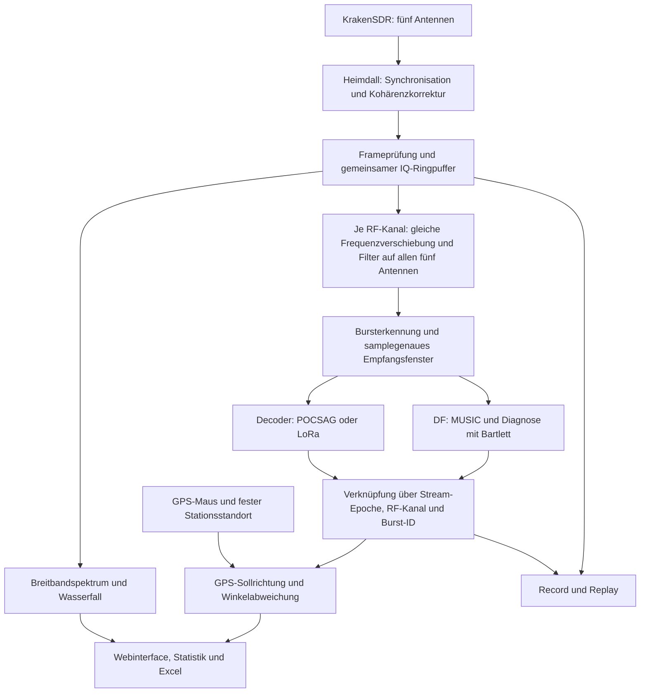

# Spezifikation: KrakenSDR BFT Direction-Finding-Demo

Stand: 12. November 2026. Technischer Entwurf nach Nutzerangaben und Quellprüfung; keine Zusicherung einer an Hardware gemessenen DF-Genauigkeit.

## 1. Festgelegter Umfang

- Ein feststehender KrakenSDR mit fünf kohärenten Empfangskanälen und GPS-Maus.
- Vorhandene LilyGO T-Decks auf 433 MHz mit DL7CR/BFT-Firmware; Änderungen und Einstellungen der Sender übernimmt der Nutzer.
- POCSAG und LoRa. Die Positionsübermittlung selbst ist das zu peilende Signal.
- Mehrere RF-Kanäle, ungefähr 15 Sekunden Sendeintervall; keine überlappenden Sender auf demselben Kanal. Unterschiedliche RF-Kanäle dürfen gleichzeitig senden.
- Emitter-ID ist das alphanumerische Rufzeichen aus der Nutzlast, nicht POCSAG-RIC, Frequenz oder zuletzt bekannter Sender.
- Freie Sicht; drei umstellbare Antennenlayouts mit gespeicherter Kanalzuordnung.
- RX-Bedienung mindestens RF-Mitte/Empfangsfrequenzen, Gain, Kanalbandbreite und FFT-Länge.
- Live-Spektrum und Azimutdarstellung mit Sollrichtung aus GPS und gemessener Richtung je Emitter.
- Heading-Abgleich an einem bekannten Emitter.
- Aufnahme von Kalibrierdaten mit einem oder mehreren bewegten Emittern; Array bleibt fest.
- Gesamt-RMS und RMS über Azimut, Vergleich der Messprofile und Excel-Export.
- Record und Replay, einschließlich nachvollziehbarer Rohdaten für erneute DF-Auswertung.
- Lokales Webinterface mit Tag-/Nachtmodus und wenigen Hauptaktionen.

## 2. Geprüfte BFT-Parameter und Telegramme

Geprüfter BFT-Stand: `4a670550cbb82a48a0e244c3bfeb102feac510cb`.

| Modulation | Befund aus dem Code |
|---|---|
| LoRa | BW 125 kHz, SF9, CR 4/5, privates Syncword 0x12, Präambel 8 Symbole |
| POCSAG | 1200 Bit/s, FSK-Hub ±4,5 kHz, alphanumerisch, Standard-RIC 1000000, Funktion 3 |

Quellen: `BFT/src/LoraModem.h`, `LoraModem.cpp`, `PocsagModem.h` und `PocsagModem.cpp`. Die installierte Firmware und ihre Einstellungen müssen bei der Inbetriebnahme gegen diesen Stand abgeglichen werden; das Repository beweist nicht den Versionsstand vorhandener Geräte.

Gemeinsame Positionsnutzlast, aus `BFT/src/beacon_payload.h`:

```text
DL7CR 49.712340 11.045670 312m 184205Z 07sat
```

Enthalten sind Rufzeichen, Breite/Länge, Höhe, UTC-Uhrzeit auf ganze Sekunden und Satellitenanzahl. Nicht enthalten sind Datum, HDOP und explizites Positionsalter. Das UTC-Feld allein ist keine samplegenaue RF-Zeitreferenz. Auch sechs Dezimalstellen der Koordinaten sind kein Genauigkeitsnachweis.

`GpsSource.cpp` akzeptiert Positionsfixes mit Alter unter fünf Sekunden. Bei Bewegung kann diese Verzögerung bereits einen erheblichen Teil des vermeintlichen DF-Fehlers erklären. Für die erste Kalibrierung langsam bewegen oder an Messpunkten kurz anhalten; Positionsalter und Bezug zwischen ausgesendeter Position und Peilzeit im Messbericht berücksichtigen. Keine ungeprüfte Änderung an den fertigen Trackern voraussetzen.

### LoRa: reicht die Paketdauer?

Bei SF9 und 125 kHz dauert ein Symbol 4,096 ms. Für die oben gezeigte 44-Byte-Nachricht ergibt die übliche LoRa-Airtimeformel mit acht Präambelsymbolen, explizitem Header, aktivem CRC und CR 4/5 ungefähr **287,744 ms**, davon **50,176 ms Präambel einschließlich 4,25 Symbolen Zusatzdauer**. Header und CRC sind bei der Inbetriebnahme gegen die tatsächlich installierte RadioLib-/Firmwarekonfiguration zu prüfen. Länge, Vorzeichen und Rufzeichen verändern die Nutzlastlänge.

Das ist eine plausible Dauer für kohärente Erfassung. Es gibt keine aus der Formel ableitbare garantierte Peilgenauigkeit oder universelle Mindestdauer. LoRa-Decodierbarkeit bei geringem SNR garantiert ebenfalls keine ausreichend genaue Peilung.

Die Bandbreite ist bei Arraygrößen unter 0,6 m räumlich unkritisch: selbst 500 kHz ergeben über 0,56 m nur ungefähr 0,0059 rad räumliche Phasenänderung über das gesamte Band. Entscheidend sind Trigger, Signalenergie, Kohärenz und die vollständige Erfassung.

### Decoderbestand

SimpleSDR enthält einen eigenen NumPy/SciPy-LoRa-Decoder sowie einen optionalen GNU-Radio/gr-lora_sdr-Weg. Im geprüften Stand ist POCSAG dort nicht integriert. Unter `BFT/tools/pocsag_rx.py` gibt es einen Offline-POCSAG-Empfänger als Referenz, einschließlich synthetischem Selbsttest.

Die bestehenden Decoder liefern keine ausreichend eindeutige gemeinsame RF-Samplezuordnung für Decoder und DF. Diese muss ergänzt werden. Eine Verarbeitungszeit bei fertigem Decode genügt nicht. Vor Übernahme von Quellcode sind die konkreten Nutzungsbedingungen der jeweiligen Quelle zu klären; die SimpleSDR-README enthält derzeit einen Lizenzplatzhalter.

Prüfergebnis: Der POCSAG-Selbsttest und 13 synthetische LoRa-PHY-Roundtrips bestehen. Der eigene LoRa-Decoder kann die aktuelle reale einkanalige Repository-Aufnahme (Pluto, 868,3 MHz) bei den geprüften SFD-Ausrichtungen nicht erfolgreich decodieren: Header-Checksum schlägt fehl. Der GNU-Radio-Weg ist hier mangels GNU Radio/PMT ungetestet. Damit ist keiner dieser Befunde ein erfolgreicher 433-MHz-Kraken-Integrationstest. Decoderkompatibilität mit echten T-Deck-Paketen ist eine frühe Integrationsaufgabe und kein bereits gelöster Adapterwechsel.

## 3. Datenfluss und Burstzuordnung



Der Abgriff liegt hinter Heimdalls Kohärenzkorrektur. Fünf unabhängig geöffnete RTL-Geräte sind kein Ersatz dafür. Heimdall liefert gemeinsame Frames mit fünf complex64-Kanälen; Shared Memory oder TCP sind mögliche Adapter.

Alle fünf Antennen teilen RF-Mitte und Aufnahmefenster. Es handelt sich nicht um fünf unabhängig abstimmbare RF-Empfänger. Alle gewünschten Kanäle einschließlich ihrer vollständigen Bandbreite und Filterränder müssen in das praktisch nutzbare Aufnahmefenster passen. Ausgangspunkt sind 2,4 MS/s; Randbereiche und störende DC-Anteile werden bei der Kanalplanung berücksichtigt. Ein bloßes Scannen weit auseinanderliegender Kanäle würde kurze Pakete verpassen und ist nicht der Standardmodus dieser Demo.

Pro RF-Kanal laufen identische komplexe Frequenzverschiebungen und Filter auf allen fünf Antennen. Filterzustände und Gruppenlaufzeiten müssen zusammenpassen. Der Kanalprozessor führt einen eigenen Samplezähler mit Abbildung auf den gemeinsamen Eingangsstrom.

Die ursprüngliche Kraken-DoA-Implementierung unterstützt freie Antennenkoordinaten und mehrere VFOs. Ihre Option `optimize_short_bursts` ändert im geprüften Stand nur die Spektrumsberechnung. Die DoA-Auswertung nutzt weiter eine ganze CPI; diese Option allein löst daher die LoRa-Anforderung nicht. Die Default-CPI umfasst bei 2,4 MS/s rund 437 ms. Paketfenster dürfen CPI-Grenzen überschreiten und sind getrennt von FFT- und UI-Aktualisierungsintervallen auszuwerten.

POCSAG erhält einen Energie-/FSK-/Präambeltrigger. LoRa erhält einen Präambel-/Chirp-Trigger; ein reiner Energie-Squelch würde schwache, noch decodierbare LoRa-Pakete unter Umständen verwerfen. Der Ringpuffer bewahrt Vorlauf und vollständigen Burst, auch wenn die Erkennung oder Decodierung später fertig wird. DF wird auf gültigen Signalabschnitten gerechnet; mehrere Unterfenster erlauben eine Stabilitätsprüfung.

### Verbindliche Ereignisidentität

```text
stream_epoch + rf_channel_id + burst_id
source_sample_start + source_sample_end
channel_sample_start + channel_sample_end
```

Dieselbe Identität wird zwischen Decoder, Peilung und Aufnahme verwendet. Eine neue Stream-Epoche beginnt nach einem Neustart, Frequenz-/Abtastwechsel oder einer echten Datenunterbrechung. Sampleindizes sind relativ zum IQ-Strom; sie werden nicht als GPS/PPS-Zeitstempel ausgegeben.

Erst das decodierte und geprüfte Paket liefert Rufzeichen und Referenzposition. Eine anonyme Peilung darf sichtbar sein, geht aber nicht in rufzeichenbezogene Fehlerstatistiken ein. POCSAG hat keinen LoRa-ähnlichen Payload-CRC: BCH-/Paritätsbefunde, gültige Textsyntax, plausible Koordinaten und Zeitbezug sind daher eigene Qualitätsmerkmale. RIC dient nur als Decoderinformation.

CAL-/DUMMY-Frames, fehlende IQ-/Delay-Locks, Übersteuerung und Datenlücken werden sichtbar protokolliert. Sie sperren die Verwendung als gültige DF-Messung. Ein Paket, das durch eine Kalibrierpause beschädigt wurde, wird nicht stillschweigend einem anderen Paket zugeordnet.

## 4. Antennenprofile

| Profil | Maße | Kanalbelegung |
|---|---|---|
| Kreis kompakt | Durchmesser 300 mm, 72°-Raster | CH0 vorne, CH1–CH4 im Uhrzeigersinn |
| Kreis groß | Durchmesser 560 mm, Nachbarabstand etwa 329 mm | Gleiche Reihenfolge; empfohlener Start |
| Quadrat mit Mitte | Seitenlänge 320 mm | CH0 vorne links, CH1 vorne rechts, CH2 hinten rechts, CH3 hinten links, CH4 Mitte |

Koordinaten werden in Metern gespeichert: x rechts, y vorne, z oben. 0° bedeutet die markierte Vorderseite, positive Winkel drehen im Uhrzeigersinn. Geografisches Heading wird getrennt gespeichert. Der Adapter zur DF-Bibliothek muss die jeweilige Vorzeichen-/Achsenkonvention ausdrücklich übersetzen; ein bekannter Sender prüft auch die Drehrichtung.

Die Software zeigt eine bemaßte Skizze mit Kraken-Kanalnummern. Maße sind editierbar; ausgewählte Standardprofile werden bei Abweichungen als benutzerdefinierte Montage gespeichert. Quadrat plus Mitte wird anhand der tatsächlichen Koordinaten ausgewertet, nicht als angenähertes Kreisarray.

Identische senkrechte Antennen, gleiche elektrische Kabellängen und eine geeignete gemeinsame metallische Grundfläche verwenden. Grundfläche, Kabelführung und Montage bleiben Teil des Messprofils. Die interne Kraken-Kalibrierung korrigiert nicht automatisch alle externen Antennen-, Kabel- und Montageeffekte. Ein Wechsel von Geometrie, Kanalbelegung oder Montage erfordert einen passenden neuen Profilstand und erneute Heading-Prüfung.

## 5. Heading und Kalibrierung

Es gibt drei getrennte Zustände:

1. **Kraken-Kohärenz:** notwendige interne Synchronisation und Phasenkorrektur.
2. **Heading:** geografischer Bezug der festen Vorderseite des Arrays.
3. **DF-Korrektur:** aus Vergleichsmessungen gelerntes, profilgebundenes Winkelkorrekturmodell.

### Heading ausrichten

Der Nutzer wählt einen decodierten bekannten Emitter. Aus fester Stationsposition und dessen aktueller Position wird die geografische Sollrichtung berechnet. Mehrere gültige Pakete liefern einen robusten zirkulären Mittelwert für den Heading-Offset. Qualitätsanzeige, Paketanzahl und Referenzzeit bleiben sichtbar. Ein manuell eingetragener bekannter Peilwinkel ist eine alternative Referenz.

Der globale Heading-Offset ist messtechnisch nicht vollständig von einem globalen DF-Bias des Referenzsignals zu trennen. Er wird für den Vergleichslauf festgehalten; ein Heading-Wechsel setzt die laufende Vergleichsstatistik auf einen neuen Profilstand. Der Stationsstandort kann aus GPS gemittelt und anschließend für den Lauf fixiert oder als vermessene Koordinate eingetragen werden. So verändert GPS-Jitter des feststehenden Empfängers nicht laufend die Referenz.

### Record Calibration Data

- Aufzeichnung bindet jeden gültigen Burst an GPS-Sollrichtung, rohen DF-Wert, Signalqualität und den aktuellen Hardware-/RX-/Heading-Stand.
- Ein oder mehrere Emitter bewegen sich um das stehende Array. Die UI zeigt Richtungsabdeckung und Anzahl je Sektor, zunächst 24 Sektoren à 15°.
- Drei gültige Pakete je Sektor sind eine erste Abdeckungsanzeige, keine Genauigkeitsgarantie. Bei einem Sender und 15 s Intervall erfordern bereits 72 Pakete mindestens ungefähr 18 Minuten. Mehrere RF-Kanäle können parallel Daten beitragen.
- Eine glatte periodische Korrektur mit wenigen Parametern wird gegenüber unbeschränkter Interpolation bevorzugt. Das endgültige Modell wird anhand unabhängiger Prüfläufe gewählt.
- Trainings- und Validierungsdaten werden nach ganzen Messläufen oder getrennten Zeitblöcken aufgeteilt. Benachbarte Pakete derselben Runde zufällig zu teilen würde die Verbesserung zu günstig darstellen.
- Erst eine unabhängige Vorher-/Nachher-Auswertung belegt eine Verbesserung. Unabgedeckte Richtungen werden ausgewiesen; dort wird keine validierte Verbesserung behauptet. Ein ungünstiges Modell bleibt deaktiviert und jederzeit abschaltbar.
- Korrekturen gelten für die erfasste Geometrie, Montage, Kanalzuordnung und den geprüften Frequenzbereich. Übertragbarkeit auf andere Umgebungen oder Gain-Einstellungen wird nicht vorausgesetzt.

## 6. Fehlerauswertung

Die Abweichung wird zyklisch auf [-180°, 180°) normiert, damit etwa 359° und 1° einen Fehler von 2° statt 358° ergeben. Referenz ist geografisch Nord. Berechnung der Sollrichtung erfolgt auf WGS84.

```text
e_raw = wrap180(azimuth_measured_true - azimuth_reference_true)
e_corrected = wrap180(azimuth_corrected_true - azimuth_reference_true)
RMS = sqrt(mean(e²))
```

Azimutsegmente werden nach der GPS-Sollrichtung gebildet; eine Gruppierung nach der gemessenen Richtung würde die Fehlerverteilung verzerren. Zusätzlich zum Paket-gewichteten Gesamt-RMS wird ein über ausreichend belegte Azimutsegmente gleich gewichteter Wert angeboten. Damit verdeckt eine langsame Bewegung in günstigen Richtungen keine Lücken.

Anzeige und Export enthalten rohe und korrigierte Ergebnisse, Anzahl akzeptierter/ausgeschlossener Messungen, Richtungsabdeckung, zirkulären Bias, Streuung und Ausschlussgründe. Unterschiedliche Hardware-/RX-/Heading-/Korrekturprofile werden nicht unbemerkt zu einem Ergebnis vermischt. Ein großer Winkelrasterwert in der Anzeige ist keine entsprechende Winkelgenauigkeit.

Die Referenzunsicherheit ist separat zu benennen. Beispiel: unabhängige seitliche Positionsfehler von je 3 m an Sender und Empfänger ergeben bei 100 m Entfernung ungefähr 2,4° Winkelunsicherheit. Ein Positionsalter von mehreren Sekunden kann bei Bewegung zusätzlich wirken. Satellitenanzahl allein erlaubt keine zuverlässige metrische Unsicherheitsschätzung.

## 7. Bedienoberfläche

Lokales Webinterface mit Tag-/Nachtmodus, ruhiger anthrazitfarbener Nachtansicht, dezenten Cyan-Akzenten und großen lesbaren Zahlen. Eigenständiger Entwurf in der gewünschten Richtung; keine behauptete pixelgenaue TRS-Lite-Nachbildung.

- Oben: Live/Replay, GPS/Fix, Kohärenzstatus, Arrayprofil und Aufnahmezustand.
- Hauptbereich links: 360°-Azimutdiagramm, gemessene Richtung und gestrichelte GPS-Sollrichtung, Emitterfarbe mit identischer Kennzeichnung in der Liste.
- Rechts: Rufzeichen, Modulation/RF-Kanal, letzte Meldung, Signalqualität, Peilwert, Sollwert und Abweichung. Veraltete Tracks werden sichtbar abgeschwächt und führen ihre letzte Empfangszeit.
- Unten: Live-Spektrum mit Kanalmarkierungen und optionalem Wasserfall; bei Auswahl eines Emitters wird dessen RF-Kanal hervorgehoben.
- Hauptaktionen: Heading ausrichten, Messung aufnehmen/stoppen, Record Calibration Data, Kalibrierung prüfen/anwenden, Aufnahme wiedergeben und Excel exportieren.
- Separate Einrichtungsseite für RF-Mitte, VFO-Frequenzen, Gain, BW, FFT-Länge, Antennenkoordinaten und GPS-Port.
- Vergleichsansicht: Gesamt-RMS, RMS je Referenzazimut, Anzahl/Abdeckung und Filter nach Rufzeichen, Modulation und Messprofil.

FFT-Länge beeinflusst Spektrumsauflösung und Anzeigelatenz. Sie wird nicht als verdeckte Einstellung der DF-Fensterdauer benutzt. Kanalbandbreite und physische Aufnahme-/Abtastbandbreite werden getrennt benannt; LoRa-BW darf nicht durch einen zu schmalen Kanalfilter beschnitten werden.

Normalablauf: Profil wählen → Hardwarestatus grün → Heading an Referenz ausrichten → Live verfolgen → Messung/Kalibrierung aufnehmen → auswerten/exportieren. Keine Terminaleingaben im normalen Demobetrieb; das Backend darf im Terminal gestartet werden und dort seine Diagnose ausgeben.

## 8. Record und Replay

Zwei Aufzeichnungsstufen:

1. **Standard:** kanaliserte kohärente Fünfkanal-IQ-Clips pro Burst, Vor-/Nachlauf, decodierter Originaltext, Samplezuordnung, GPS, Qualitätsflags, Peilergebnisse, Profile und zeitlich passende Spektrum-/Wasserfalldaten. Ermöglicht Replay und erneute DF-Auswertung innerhalb der gespeicherten Kanäle/Bandbreiten.
2. **Expertenoption:** zeitlich begrenzte vollständige Breitband-IQ-Aufnahme aller fünf Kanäle. Notwendig, wenn später neue Kanäle oder andere Kanalbandbreiten aus demselben Lauf untersucht werden sollen.

Bei 2,4 MS/s und fünf complex64-Kanälen sind vollständige Aufnahmen ungefähr 96 MB/s beziehungsweise 5,76 GB/min groß, vor Headern und Dateisystemaufwand. Der Speicherbedarf von Burstclips hängt von Filterbandbreite und tatsächlicher Empfangszeit ab. Ein reines Ereignislog kann die UI wiedergeben, ersetzt aber keine kohärente IQ-Aufnahme für neue Peilalgorithmen.

Sitzungsformat: versioniertes Manifest, Messprofil-Snapshots, Ereignis-/Messwertdatenbank und binäre IQ-Clips mit Typ-, Kanal- und Längenangaben. Jeder Clip hat Sample- und Burst-ID; Aufnahmelücken werden ausdrücklich festgehalten. Ein Manifest kann mehrere Stream-Epochen enthalten. Replay verwendet die identische Verarbeitungskette und zeigt klar den Modus sowie Originalzeit und Wiedergabegeschwindigkeit. Rohdaten und frühere Auswertungen bleiben erhalten.

## 9. Excel-Export

`.xlsx` mit getrennten Blättern:

- Sitzung und Messprofile einschließlich dokumentierter TX-Parameter.
- Einzelmessungen: Zeit, Rufzeichen, Modulation, RF-Kanal, Sender-/Empfängerposition, Referenzazimut, rohe/korrigierte Richtung, Winkelabweichungen, Signal-/Decoderqualität und Ausschlussgrund.
- Gesamtwerte je Profil und Emitter/Modulation.
- Azimutsegmente mit Grenzen, Anzahl, Bias und RMS vor/nach Korrektur.
- Kalibrierung: Modell-/Profilversion, Trainings-/Prüfläufe, Abdeckung und unabhängige Vorher-/Nachher-Werte.

IQ bleibt als zugeordnete Aufnahme außerhalb von Excel; ein Verweis stellt den Bezug her. CSV ist eine optionale zusätzliche Ausgabe. Empfangene Texte werden als Textzellen exportiert und nicht als Excel-Formeln interpretiert.

## 10. Umsetzung und Abnahme

Empfohlene Reihenfolge mit überprüfbaren Zwischenständen:

1. Gemeinsames Ereignis-/Profilmodell, Arraygeometrien, WGS84-Referenz und zyklische Fehlermathematik; reproduzierbare synthetische Fünfkanalaufnahmen für Replay.
2. Heimdall-Adapter, Frameprüfung, Kanaliserung und Ringpuffer; Tests von CPI-Grenzen, Datenlücken, Kalibrierunterbrechungen und korrekter Kanalzuordnung.
3. POCSAG- und LoRa-Decoder mit samplegenauer Burst-ID. Peilung separat vom Decoder, anschließend eindeutige Verknüpfung mit Rufzeichen/Position.
4. Lokales Webinterface, Messprofile, Heading, Aufzeichnung/Replay und Excel-Export.
5. Aufnahme von realen Kraken-/433-MHz-BFT-Paketen, Abgleich der Antennendrehrichtung und RF-/GPS-Zeitbezüge. Danach Kalibrierung und unabhängige Validierung.

Für beide Modulationen wird die Kette getrennt bewertet: erkannt → decodiert → gültig gepeilt → eindeutig zugeordnet. Pro Stufe Zahlen und Ausschlussgründe erfassen; erfolgreiche Pakete allein sagen nichts über verpasste Sendungen aus. Soweit möglich dienen die TX-Logs der Tracker als Referenz für die tatsächlichen Sendeversuche. Winkel-RMS wird über bekannte Richtungen, verschiedene Pegel und alle drei Layouts gemessen.

Zu prüfende Kernfälle: Burst über CPI-Grenze, gleichzeitig belegte verschiedene RF-Kanäle, dasselbe Rufzeichen nach Frequenzwechsel, Sender ohne gültige Position, UTC-Tageswechsel, verlorene Verbindung, Retuning mit Neukalibrierung, Übersteuerung, Replay-Parität und Kalibrierung auf getrennten Prüfläufen. Ohne Daten mit echter Fünfkanal-Phaseninformation wird keine Kraken-Peilgenauigkeit ausgewiesen.

## 11. Noch benötigte Angaben zur Hardware-Inbetriebnahme

- Konkrete RF-Kanalliste beziehungsweise gesamte gewünschte Frequenzspanne.
- Modell der GPS-Maus und Ausgabeformat/Schnittstelle; zunächst NMEA über USB-Seriell annehmen.
- Bestätigung des ersten Linux-Hosts; Windows-Browser kann unabhängig davon genutzt werden.
- Tatsächlicher BFT-Firmwarestand und Antennen-/Kabellängen bei der Messaufnahme dokumentieren.

Diese Angaben blockieren den Softwareentwurf nicht. Die Frequenzspanne ist jedoch vor der Zusage eines gleichzeitigen Liveempfangs aller Kanäle zu prüfen.
